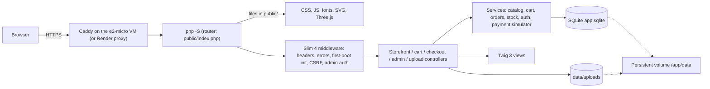

# Habi

Educational Filipino-inspired handbag storefront. Products and origin labels are fictional demonstrations, not real goods or verified maker stories. M0–M6 provide discovery, searchable SQLite inventory, real procedural exterior/interior 3D inspection, a session-only cart, simulated guest checkout with atomic inventory and an administrator panel for products, stock and orders. M8 adds the production Docker image, CI and deployment to a Google Cloud e2-micro VM, with Render as the alternative ([Deploy](#deploy)). The [published UI and design system](https://fit-igloo-66636772.figma.site/) is the **1:1 visual authority**; [DSD](docs/DSD.md) records its PHP/Twig APIs. Local implementation is separate from the review/merge requirements recorded in BUILD.

## Local setup — three steps

Requires PHP **8.2+**, Composer 2, and PHP extensions `pdo_sqlite`, `mbstring`, `dom`, `xml`, `xmlwriter` (the XML extensions support the development tools). No Node build, database server or CDN is needed.

1. Install pinned PHP dependencies:
   ```sh
   composer install
   ```
2. Copy and configure local settings:
   ```sh
   cp .env.example .env
   php -r 'fwrite(STDOUT, "Local admin password: "); echo password_hash(rtrim(fgets(STDIN), "\r\n"), PASSWORD_DEFAULT), PHP_EOL;'
   ```
   Choose a local-only password; the prompt echoes input, so use a private terminal. Paste the generated hash into `ADMIN_SEED_PASSWORD_HASH` in `.env`, keeping **single quotes**. Set `ADMIN_SEED_EMAIL` and optionally `ADMIN_SEED_NAME`. Never put a plaintext password in `.env` or commit it. Process environment values override `.env` settings.
3. Start the development server from the repository root:
   ```sh
   php -S localhost:8000 -t public public/index.php
   ```
   Open <http://localhost:8000>. The first request initializes `data/app.sqlite` and seeds 10 fictional bags across four categories plus your configured administrator. Later requests/restarts preserve data and do not reset credentials. Sign in at <http://localhost:8000/admin> with `ADMIN_SEED_EMAIL` and the password you hashed. A database created before M6 is upgraded in place on the next request (the `login_attempts` table is added; no data is reset).

`public/index.php` is also the built-in server's router. Keep that last argument: without it PHP 8.2 treats any dotted path as a static file and answers 404 for uploaded images (`/uploads/<name>.png`) before the application runs. Real files in `public/` are still served directly. Optionally set `PHP_CLI_SERVER_WORKERS=4` so a simulated payment does not block other requests.

`DB_DSN=sqlite:data/app.sqlite` resolves relative to the repository root; an absolute SQLite path is also supported. The database directory must be writable. Missing/invalid first-boot admin settings prevent initialization rather than creating a default password. Fix `.env` and request the page again. No credentials or internal errors are shown in the browser; inspect server stderr for local diagnosis. Optionally set `APP_URL` (for example `APP_URL=https://habi.example.com`, no trailing slash) to pin the absolute base URL used for canonical links and Open Graph tags; when blank it is derived from each request's scheme and host.

## Data and intentional reset

Money is integer centavos (₱1 = 100). Product images use the published reference's SVG illustration family; each product has a procedural `three_config` consumed by the real viewer, including lining and authored pocket details. Administrator uploads are stored in `data/uploads/` (gitignored, outside the web root). Asset/font provenance: [DSD §6](docs/DSD.md#6-assets-fonts-and-provenance). Schema: [`migrations/`](migrations/) (`001_schema.sql` base; later files are idempotent upgrades), seed: [`seed/`](seed/). No inventory reset is needed for interior inspection.

```sh
php seed/seed.php --force
```

**Destructive:** this explicitly resets demo data, including orders, inventory, administrator and sign-in throttle records, using current environment settings. Uploaded files in `data/uploads/` are not deleted. Do not run against data you need. Running without `--force` refuses the reset.

## Checks

```sh
composer validate --strict
vendor/bin/phpunit
composer cs      # PSR-12: src public/index.php seed tests
composer lint    # php -l over src public seed tests
docker build -t habi .
```

GitHub Actions (`.github/workflows/ci.yml`) runs the same checks on every pull request and push to `main`, then boots the image on an empty volume. That job checks `/`, `/products`, a static file, a dotted application path and a restart preserving the catalog.

PHPUnit uses isolated databases, not your local demo inventory. Catalog coverage includes filters/order/pagination and active/sold-out visibility; inspection coverage includes active-only configs and ordered galleries. Cart boundary coverage includes cumulative stock caps, persistent corrections/removals, malformed quantities, session isolation and CSRF rejection. Inspect the actual changed surface at 360 px and wide widths with keyboard navigation; PHP checks do not establish visual accessibility. On product pages, also exercise viewer loading/retry, WebGL fallback, pause/reduced motion and mobile dialog close/Esc/focus return. Exact observed scenarios and commands are recorded in [BUILD](docs/BUILD.md).

Admin coverage includes the sign-in throttle and lockout expiry, stale/negative stock adjustments and their audit rows, one-step fulfilment, atomic cancel-and-restore, exact peso parsing, content-checked uploads and in-place upgrade of pre-M6 databases.

Exact-cutover visual, keyboard, no-JS and recovery checks are recorded in [BUILD — Exact published-reference cutover](docs/BUILD.md#exact-published-reference-cutover-2026-11-10); earlier reconciliation and performance measurements remain historical.

## Deploy

The image is `php:8.2-cli` with production Composer dependencies, running the same front controller as development: `php -S 0.0.0.0:$PORT -t public public/index.php` (N6). It defaults `APP_ENV=production`, `DB_DSN=sqlite:/app/data/app.sqlite`, `PORT=8080` and four server workers. `.env`, local data, uploads and `vendor/` are never copied into the image (allowlist `.dockerignore`). Configuration comes only from environment variables.

**Persistent data:** `/app/data` holds `app.sqlite` and `uploads/`. Mount a volume there. The first request on an empty volume migrates and seeds 10 products plus the administrator from `ADMIN_SEED_EMAIL`/`ADMIN_SEED_PASSWORD_HASH`. Every later boot, restart and redeploy keeps inventory, orders, uploads and the administrator. Changing the seed variables afterwards does not reseed or replace the administrator. Without seed variables an empty volume is left uninitialized and visitors get a generic 500 page. Only the explicit `php seed/seed.php --force` resets data. Deleting the volume deletes the shop.

Run the production image locally:

```sh
docker build -t habi .
docker volume create habi-data
docker run --rm -p 8080:8080 -v habi-data:/app/data \
  -e ADMIN_SEED_EMAIL=admin@example.test \
  -e ADMIN_SEED_PASSWORD_HASH='<hash from the setup step>' habi
```

Open <http://localhost:8080> (browsers accept the production Secure session cookie on `localhost`; use HTTPS elsewhere). Stopping and re-running with the same volume keeps all data.

### Google Cloud e2-micro (production)

One Compute Engine `e2-micro` VM runs `deploy/gce/compose.yaml`: the Habi image plus [Caddy](https://caddyserver.com/), which redirects HTTP to HTTPS and obtains and renews the Let's Encrypt certificate for your domain. Data lives in `/srv/habi/data` on the VM's disk (mounted at `/app/data`).

**Cost.** Always Free covers one `e2-micro` in `us-west1`, `us-central1` or `us-east1`, 30 GB of **standard** persistent disk, and 1 GB of outbound traffic a month. The VM's public IPv4 address is **not** free: it costs $0.005/hour, about **$3.65/month**, which credits can cover ([pricing](https://cloud.google.com/vpc/network-pricing)). Traffic beyond 1 GB a month is billed. Set a budget alert under Billing → Budgets.

**1. Create the VM** in [Cloud Shell](https://shell.cloud.google.com), which has `gcloud` preinstalled. `us-west1` is the closest free region to the Philippines.

```sh
PROJECT=your-project-id
REGION=us-west1
ZONE=us-west1-b
gcloud config set project "$PROJECT"
gcloud services enable compute.googleapis.com
gcloud compute addresses create habi-ip --region "$REGION"
gcloud compute addresses describe habi-ip --region "$REGION" --format='value(address)'
gcloud compute firewall-rules create habi-allow-web --network default \
  --allow tcp:80,tcp:443,udp:443 --target-tags habi-web
gcloud compute instances create habi --zone "$ZONE" --machine-type e2-micro \
  --image-family debian-13 --image-project debian-cloud \
  --boot-disk-size 30GB --boot-disk-type pd-standard \
  --address habi-ip --tags habi-web
```

Keep `--boot-disk-type pd-standard`: the default balanced disk is not free. GitHub Actions deploys over SSH, which needs the default network's `default-allow-ssh` rule (port 22). Check it with `gcloud compute firewall-rules list`.

**2. DNS.** At your domain registrar, add an **A record** for your hostname (for example `shop.example.com`) pointing to the address printed above. Wait until `dig +short shop.example.com` returns it. Caddy can only obtain the certificate after that. On **Cloudflare**, set the record to **DNS only** (grey cloud): a proxied record hides the VM's address, which breaks the SSH deploy and the certificate setup.

**3. Deploy key** (for GitHub Actions), in Cloud Shell:

```sh
ssh-keygen -t ed25519 -N '' -C habi-deploy -f habi_deploy
cat habi_deploy.pub
```

**4. Set up the VM.** Generate the admin password hash as in [Local setup](#local-setup--three-steps) step 2. In Cloud Shell, which has Docker, you can use `read -rsp 'Admin password: ' P; echo; docker run --rm -e P="$P" php:8.2-cli php -r 'echo password_hash(getenv("P"), PASSWORD_DEFAULT), PHP_EOL;'; unset P`. Then open a shell on the VM with `gcloud compute ssh habi --zone "$ZONE"` and run:

```sh
sudo apt-get update && sudo apt-get install -y git
git clone https://github.com/fr-anz/COMP-20163-WEB-DEVELOPMENT.git habi-setup
sudo HABI_DOMAIN=shop.example.com \
  ADMIN_SEED_EMAIL=you@example.com \
  ADMIN_SEED_PASSWORD_HASH='$2y$12$…your hash…' \
  DEPLOY_PUBKEY='ssh-ed25519 AAAA… habi-deploy' \
  sh habi-setup/deploy/gce/setup.sh
```

Keep the hash in **single quotes** here. `setup.sh` is idempotent and does the following:
- installs Docker and adds 1 GB of swap
- creates the `deploy` user, `/srv/habi/{app,data}`, and the settings files `/srv/habi/habi.env` and `caddy.env`; existing files are never overwritten
- installs the deploy key with a forced command, so the key can only run `deploy/gce/update.sh` with a commit already on `main`
- builds and starts the stack, and checks that `/` is healthy

It ends by printing a `GCE_KNOWN_HOSTS` line. Until this branch is merged, add `--branch ad/m8-deploy` to the clone and `HABI_BRANCH=ad/m8-deploy` to the `sudo` line.

**5. Auto-deploy from GitHub.** In Cloud Shell, or anywhere `gh` is signed in to this repository:

```sh
gh secret set GCE_SSH_KEY < habi_deploy
gh variable set GCE_KNOWN_HOSTS --body 'shop.example.com ssh-ed25519 AAAA…'   # line printed by setup.sh
gh variable set GCE_HOST --body shop.example.com
rm habi_deploy
```

After that, each push to `main` runs the CI checks. Only when they pass does the **Deploy to Google Cloud** job run `update.sh <commit>` over SSH and check `https://<host>/`. That script checks out the commit, rebuilds, restarts, and waits for a healthy `/`. Without `GCE_HOST`, the deploy job is skipped.

**Operate.** All commands run on the VM:

| Task | Command |
|---|---|
| Status | `sudo -u deploy docker compose -f /srv/habi/app/deploy/gce/compose.yaml ps` |
| Logs | `sudo -u deploy docker compose -f /srv/habi/app/deploy/gce/compose.yaml logs -f --tail 50` |
| Manual deploy of `main` | `sudo -u deploy /srv/habi/app/deploy/gce/update.sh` |

Online backup to a new timestamped file in `/srv/habi/data` (SQLite `VACUUM INTO` will not overwrite an existing file):

```sh
sudo -u deploy docker compose -f /srv/habi/app/deploy/gce/compose.yaml exec -T app \
  php -r '(new PDO("sqlite:/app/data/app.sqlite"))->exec("VACUUM INTO \"/app/data/backup-" . date("Ymd-His") . ".sqlite\"");'
```

Containers restart automatically after a reboot. Data in `/srv/habi/data` survives redeploys, reboots and image rebuilds. Deleting the VM or its boot disk deletes the shop.

Verify: `https://<domain>/` returns 200, `/admin` signs in with the hashed password, and an order or stock change survives `update.sh` and `sudo reboot`.

### Render (alternative)

`render.yaml` defines a Docker web service with a 1 GB persistent disk at `/app/data`, health check `/`, and deploys after checks pass. **New → Blueprint** → this repository, then enter the prompted `ADMIN_SEED_*` values (hash without quotes). Persistent disks need a paid instance type. A free instance has no disk, so its data is lost on every deploy.

## Architecture and scope



`public/index.php` → Slim 4 → storefront/cart/checkout/admin controllers → services/PDO → Twig 3; PSR-4 `Habi\` classes live in `src/`. Support helpers load environment settings and provide PDO SQLite, with transactional initialization and idempotent upgrades. Templates autoescape HTML. Global middleware protects every POST with a per-session CSRF token and redirects every `/admin` path except `/admin/login` to sign-in. Native PHP session cookies are session-only, HttpOnly and SameSite=Lax; Secure is set for HTTPS or `APP_ENV=production`. Admin sign-in regenerates the session ID and CSRF token. Responses are `no-store`.

| Route | Available behavior |
|---|---|
| `/` | Short skippable introduction, material/bag exploration without purchase, optional featured collection |
| `/products?q=&category=&sort=&hide_sold_out=&page=` | Active products; literal name/description/material search; category; `featured`/`newest`/`price_asc`/`price_desc`; Hide sold-out bags; eight products per page |
| `/product/{slug}` | Original-image gallery, details/stock, illustrative labels, exterior/interior 3D; stock-bounded quantity and Add to bag |
| `/api/product/{slug}/stock` | Uncached JSON `{slug, stock, low_stock_threshold}`; missing/inactive products return JSON 404 |
| `/api/product/{slug}/3d` | Uncached per-product procedural JSON config; missing/inactive products return JSON 404; sold-out products remain inspectable |
| `/cart` | Full bag page; JSON with authoritative cart/count/totals and rendered fragments when requested via `Accept: application/json` |
| `POST /cart/add`, `/cart/update`, `/cart/remove` | Session cart mutations with CSRF and live-stock reconciliation; native forms redirect to `/cart`, enhanced forms update the drawer and badge |
| `/checkout`, `POST /checkout/shipping` | Guest shipping form with server validation and region fees |
| `/checkout/payment`, `POST /api/payment/simulate` | Mock card validation and 1.5–2.5 s simulated processing; no real gateway |
| `/checkout/review`, `POST /checkout/place` | Approved-payment-only review, preissued retry key and atomic stock/order/audit transaction |
| `/order/{orderNumber}` | Session-owned confirmation with immutable item/address/price snapshots and simulated delivery estimate |
| `/uploads/{name}` | Validated administrator product images served with their detected MIME type; any other name is 404 |
| `/admin/login`, `POST /admin/logout` | Administrator sign-in with generic errors; five failures per email+IP lock sign-in for 60 s |
| `/admin` | Dashboard: active products, units, low/sold-out count, orders to fulfil, low-stock alerts, recent orders |
| `/admin/products…` | Create/edit/archive/restore products (centavo prices, labels, dimensions, threshold, 3D config, image upload or demo illustration) |
| `/admin/inventory…`, `POST /admin/products/{id}/stock` | Two-step stock adjustment with reason; stale reviews are re-shown instead of applied |
| `/admin/orders…` | Status/date filters, detail, one-step fulfilment, cancel-before-shipping that restores stock |
| `/admin/audit` | Stock audit log: product, old → new, reason, actor, UTC time |

Search and category combine; pagination retains those filters and sorting. Out-of-range pages use the nearest available page. Sold-out products remain visible unless “Hide sold-out bags” is selected; inactive products do not. A missing/inactive product detail returns 404.

Canonical visual source: [`public/assets/css/app.css`](public/assets/css/app.css), using the published semantic roles and shared native component/utility classes. [DSD](docs/DSD.md) is the visual/asset contract: reproduce the reference, not the earlier UI. Fonts and SVG artwork are local; no React runtime, Tailwind build or CDN is needed. Reference photographs are not website assets. PRD §9 resolves sample business-value conflicts without authorizing visual redesign.

### Exterior and interior viewer

Open a product and choose **3D**. Desktop inspection is inline; below 900 px
it opens a fullscreen dialog. Drag/touch to orbit or focus the stage and use arrow
keys; named rotation buttons also work without dragging. **Peek inside** reveals
the lining and configured pockets in an illustrative cutaway. Satchel/clutch flaps
fold back; open totes and zip-top slings do not acquire an invented lid.
**Back outside** restores the previous exterior orbit/zoom. **Reset orientation**
resets the current mode without leaving the interior.

Idle rotation has pause/resume outside and is suspended inside. Reduced motion
disables camera/flap tweens, automatic rotation and inertia; keyboard toggles also
switch immediately. Photos remain available without JavaScript. If WebGL is
unavailable, the original illustration remains with an explanatory note;
fetch/module failures offer retry.

### Session bag

Add from the collection or a product page. The header bag opens an accessible drawer
with a full-page alternative at `/cart`; native forms and that page work without
JavaScript. Quantities and totals use current inventory/prices, not a client snapshot.
Stock reductions clamp quantities or remove unavailable lines and leave explanatory
notices visible across reloads. Adding to the bag does not reserve or decrement stock.

The bag lasts only for the native PHP session: there is no saved cart after expiry.
An expired form requires a fresh session token before adding again. Shipping estimates
use PRD R12 rates and are free only **above** ₱5,000. Proceed to checkout opens the
guest shipping form; stock is checked again atomically when Place order is submitted.

### Simulated checkout

Shipping → Payment → Review → Place order → Confirmation is enforced on the server.
Shipping rates: Metro Manila ₱120, Luzon ₱180, Visayas ₱220, Mindanao ₱250; exactly
₱5,000 is not free, while ₱5,000.01 is. Enter fictional contact/address details only.

**SIMULATED PAYMENT — no real transaction occurs.** Use a future `MM/YY` and any
3–4 digit test CVC. Never enter real card details.

| Test card | Result |
|---|---|
| `4242 4242 4242 4242` | Approved simulation; Place creates one paid demo order |
| `4000 0000 0000 0002` | Card declined; no order or decrement |
| `4000 0000 0000 9995` | Insufficient funds; no order or decrement |

Other Luhn-valid cards approve. Invalid details show inline errors; declines preserve
shipping and the bag. Only result, last four digits and brand are retained, never full
card number, expiry or CVC. Changing shipping or bag quantities revokes approval;
price changes require reviewing the bag again.

Review issues the idempotency key before displaying Place. Repeating Place returns
the same `H-YYYYMMDD-NNNN` order without consuming another item. SQLite `BEGIN IMMEDIATE`
serializes placement; guarded decrements, stock audit, order and item snapshots commit
or roll back together. Stock/price conflicts explain the correction on the bag page.
Transient failures retain the key for an explicit safe retry. Confirmation is visible
only to the originating session; expiry also loses access. Delivery is explicitly
simulated: nothing will be charged or shipped. Administrators can advance and cancel
these orders in `/admin/orders` (see below).

### Admin panel

Products, inventory, orders and the stock audit follow the published Admin example;
dialogs are real URLs, so every flow works without JavaScript (`admin.js` adds focus
containment, Esc and filter auto-submit). Stock is set once when a product is added
and afterwards changes only through **Inventory → Adjust stock** (change, reason,
optional note → confirm). Checkout decrements, adjustments, initial stock and
cancellations each write a `stock_audit` row. Products are archived, never deleted,
so order history stays intact. Fulfilment moves paid → packed → shipped → delivered
one step at a time; only paid or packed orders can be cancelled, which restores
every item's stock in one transaction. Images must be real JPEG, PNG or WebP files
up to 2 MB (checked by content); otherwise choose a seeded demo illustration.

### Viewer dependencies

Three.js **0.160.1 / r160**, MIT, is vendored locally: official
[`three.module.min.js`](https://cdn.jsdelivr.net/npm/three@0.160.1/build/three.module.min.js)
is saved as `public/assets/vendor/three/three.module.js`, alongside the matching
[`OrbitControls.js`](https://cdn.jsdelivr.net/npm/three@0.160.1/examples/jsm/controls/OrbitControls.js)
and [`LICENSE`](public/assets/vendor/three/LICENSE). The import map uses
`three.module.php?v=0.160.1`: this small PHP adapter negotiates compression with
PHP's **zlib** extension, needed for the recorded N1 timing on the uncompressed
development server. Upgrade both modules from the same release, retain its license,
and change the import-map version to invalidate immutable caching. No CDN is
contacted at runtime and no frontend build step is required. Geometry and
canvas-generated material patterns are original Habi demo artwork, not supplied
reference photographs or downloaded models.

Requirements: [PRD](docs/PRD.md) · architecture: [SDD](docs/SDD.md) · deployment: [SDD §12](docs/SDD.md#12-deployment-design-n6-build-m8) · evidence: [BUILD](docs/BUILD.md). No real payments are processed. Local implementation does not imply human PR review, merge or deployment.
